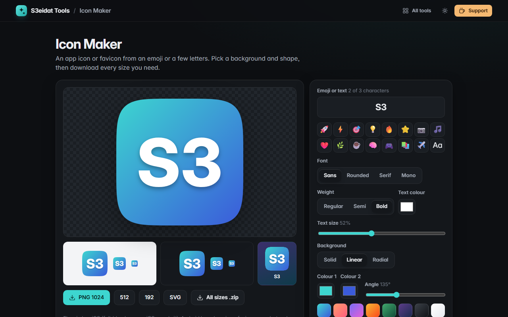

# Icon Maker

> App icons and favicons from an emoji or a few letters. Free, private, and it runs entirely in your browser.

### ▶ [Open Icon Maker](https://s3eidat.github.io/icon-maker/)



## Features

- **Emoji or 1–3 characters** (counted as real characters, so 👍🏽 or 👨‍👩‍👧 is one), with quick picks
- Fonts: sans, rounded, serif, mono; three **weights**; text colour and size; optional **soft shadow**
- Backgrounds: **solid, linear gradient (any angle) or radial**, with presets
- Shapes: **square, rounded, squircle** (superellipse) or **circle**
- Live previews at 64, 32 and 16 px on light and dark, plus a home-screen mock
- Download **PNG at 1024, 512 or 192**, or **SVG**
- **All sizes .zip**:
  - `ios/` AppIcon 20–1024 px, full-bleed squares (iOS applies its own rounded mask)
  - `android/` launcher icons for mdpi → xxxhdpi, and a 512 px Play Store icon
  - `web/` favicons 16/32/48, `apple-touch-icon.png`, PWA icons 192/512, a maskable 512, `icon.svg`, `site.webmanifest` and a `<head>` snippet

The SVG uses real text, so it shows with the fonts on the viewer's device; use the PNGs where the exact look matters
(emoji especially differ between systems).

## Privacy

Icons are drawn on your device with `<canvas>`. There is no server, no account, no analytics.
The page ships with a strict Content-Security-Policy (`connect-src 'self'`), so the browser
itself blocks any attempt to send data anywhere.

## Run it yourself

It's plain HTML, CSS and JavaScript with no build step:

```bash
git clone https://github.com/s3eidat/icon-maker
cd icon-maker
python -m http.server 8000
```

Then open http://localhost:8000.

## Support

If this saved you time, **[buy me a coffee ☕](https://s3eidat.github.io/coffee/)**. It keeps every tool free.

---

Part of **[S3eidat Tools](https://s3eidat.github.io/)**: 100+ free, private tools that run in your browser. MIT licensed.
